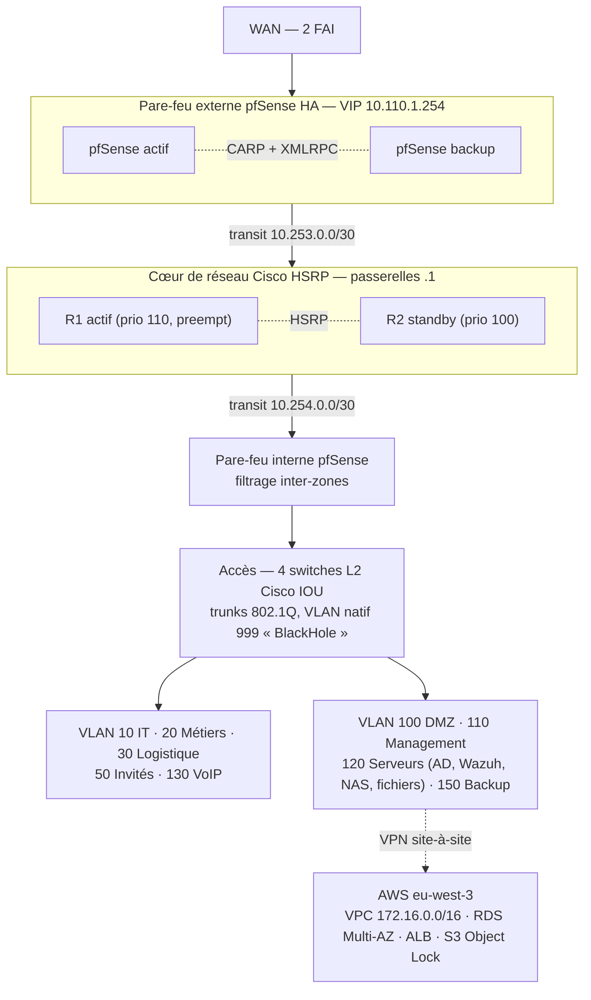

# Drakonis — Blue Team

> Projet final du bootcamp cybersécurité Jedha (promotion juin 2026), réalisé en équipe de cinq.
> Ce dépôt présente **ma partie** : la conception réseau et sécurité de l'infrastructure, sa supervision, puis le test d'intrusion croisé contre l'équipe adverse.
>
> *English summary below.*

## Le scénario

Drakonis est une PME fictive de vente en ligne de produits dérivés pop culture. L'objectif était de **construire et défendre** son infrastructure hybride (on-premise sous GNS3 + AWS eu-west-3 pour la conformité RGPD), puis de **mener un pentest Grey Box de 48 h** contre l'infrastructure d'une autre équipe, pendant que celle-ci attaquait la nôtre.

**Mon rôle :** lead réseau et sécurité (segmentation, pare-feu, haute disponibilité, supervision), puis co-auteur du rapport de pentest offensif.

**Équipe :** Sami, Nicholas, Hadi, Cédric et moi. La partie applicative (e-commerce NestJS / Next.js, CI/CD, Terraform) est dans le dépôt de Hadi : [hadimouter/drakonis](https://github.com/hadimouter/drakonis).

## Architecture

Le schéma détaillé est dans [`schemas/architecture.drawio`](schemas/architecture.drawio) (à ouvrir avec [diagrams.net](https://app.diagrams.net)).

## Ce que j'ai construit

### 1. Segmentation et plan d'adressage
- Convention **`10.[VLAN].[fonction].[hôte]`** : une adresse IP se lit d'un coup d'œil (`10.120.3.1` = VLAN serveurs, fonction AD, DC1).
- 10 VLAN métier et techniques, plus un **VLAN natif 999 sans IP** sur les trunks contre le VLAN hopping (double tagging).
- Détail : [`docs/plan-adressage.md`](docs/plan-adressage.md) · arbitrages d'équipe : [`docs/decisions-architecture.md`](docs/decisions-architecture.md).

### 2. Politique de pare-feu pfSense
- **Deny by default + liste blanche par VLAN**, environ 55 règles sur 9 interfaces, alias réseau et ports.
- Ordre des règles pensé contre le mouvement latéral : une DMZ compromise ne peut joindre que la base de données ; un serveur compromis ne peut pas initier de connexion vers les postes ; un invité ne voit rien du réseau interne.
- Détail et tests de validation : [`docs/politique-firewall-pfsense.md`](docs/politique-firewall-pfsense.md).

### 3. Haute disponibilité
- Pare-feu externe en **cluster CARP** avec synchronisation de configuration **XMLRPC**.
- Cœur de réseau en **HSRP** (R1 actif, R2 en secours, préemption).

### 4. Supervision
- **Wazuh** (manager, indexer, dashboard) sur Debian dans le VLAN serveurs, avec agents et **Sysmon** sur les postes Windows, et ingestion des journaux AWS (CloudTrail, GuardDuty).
- **Alerting Wazuh → Discord** : intégration développée de zéro (script Python appelé par le bloc `<integration>` de `ossec.conf`, correction d'un bug de lecture des arguments, filtrage des alertes SCA trop bruyantes). *Le script nettoyé sera ajouté dans `supervision/`.*
- Trouvailles en cours de route : règles UFW asymétriques entre IPv4 et IPv6 ; injection de journaux de test avec `logger -t` sous systemd-journald ; empreintes TCP différentes entre une attaque lancée depuis WSL et depuis Kali natif.

## Pentest croisé (48 h, Grey Box, orientation Purple Team)

| Sens | Résultat | Détail |
|---|---|---|
| **Nous → équipe adverse** | 11 vulnérabilités (0 critique, 3 élevées, 4 moyennes, 4 faibles), 1 exploitée. Domain Admin non atteint. | [`pentest/synthese-pentest-offensif.md`](pentest/synthese-pentest-offensif.md) |
| **Équipe adverse → nous** | 13 vulnérabilités dont 1 critique (patch management Windows). **Aucun chemin vers Domain Admin.** | [`pentest/retour-pentest-subi.md`](pentest/retour-pentest-subi.md) |

Le rapport complet n'est pas publié : il décrit l'infrastructure d'une autre équipe. La synthèse est anonymisée.

## Ce que j'en retiens

- **Sécuriser le transport avant d'attaquer** : une double encapsulation VPN + SSH faisait tomber RDP et SMB. Le diagnostic (fragmentation, MTU ramenée à 1300) a débloqué tout le reste de l'audit.
- **Créditer ce qui tient** autant que ce qui casse : c'est ce qui rend un rapport utile à l'équipe qui le reçoit.
- **Notre angle mort était le patch management**, pas la configuration. La supervision atténue, elle ne compense pas.

## Limites assumées

- Laboratoire pédagogique : certificats auto-signés, pas de MFA, VLAN Backup qui traverse encore les routeurs.
- **Suricata** était prévu dès la conception, mais n'a pas été déployé dans le temps imparti : c'est le premier axe d'amélioration identifié.

---

## English summary

Final project of the Jedha cybersecurity bootcamp (team of five). I was the **network & security lead**: VLAN segmentation with a self-describing addressing scheme, default-deny pfSense policy (~55 rules, 9 interfaces), **pfSense CARP/XMLRPC HA** and **Cisco HSRP** core, **Wazuh + Sysmon** monitoring with AWS log ingestion and a **custom Wazuh → Discord alerting integration** written from scratch. During the 48-hour cross pentest, my team found 11 vulnerabilities on the opposing infrastructure (Kerberoasting, weak password policy, unauthenticated order API…), while the opposing team found no path to Domain Admin on ours. Our main gap was Windows patch management.
